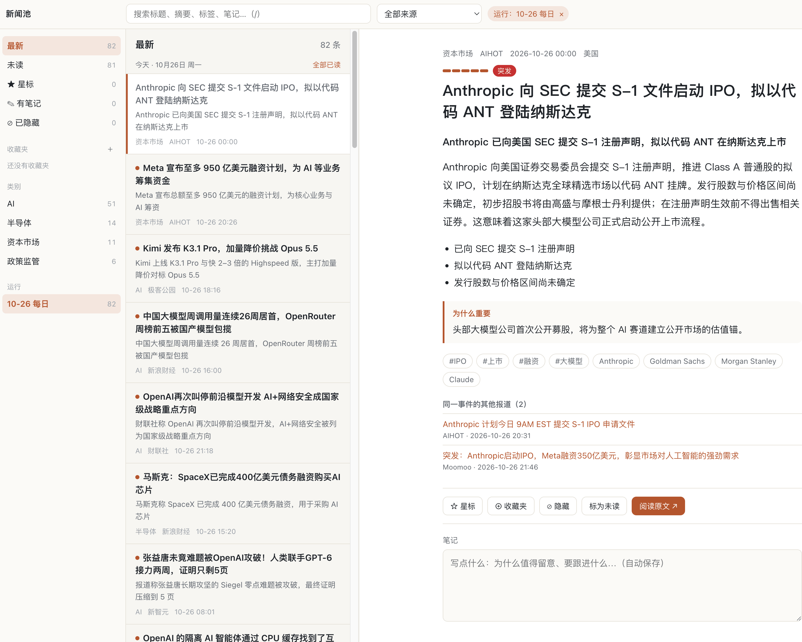
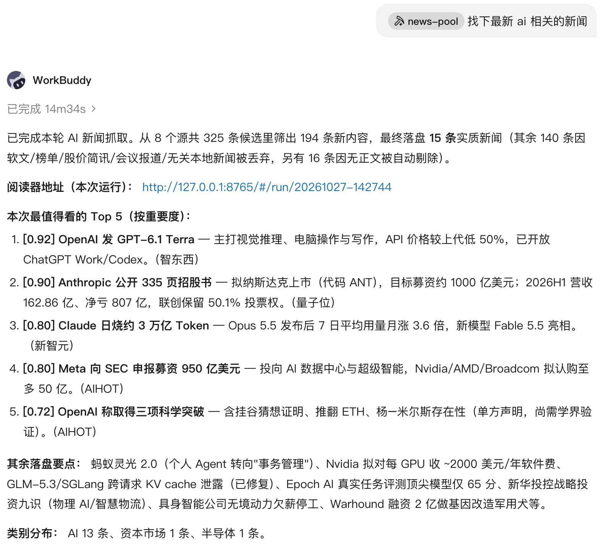
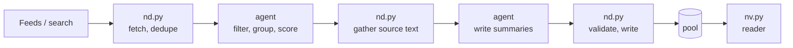

# news-pool

**Let the AI agent you already pay for (Codex, Claude Code, WorkBuddy…) sift through the news for you every day.** It pulls stories from feeds and news search, drops what you don't care about, merges duplicate coverage, ranks by importance and writes a summary for each story. The results are saved as local files that you read in your browser. The whole pipeline runs inside the agent on your existing subscription: **no API key, no pay-per-use billing.**

[](https://github.com/lxucs/news-pool/actions/workflows/ci.yml)
[](LICENSE)


[中文](README.md) | English



> The skill, summaries and reader UI are in Chinese: the project is built for Chinese-language news and Chinese readers. The pipeline itself is language-neutral, and English sources are summarized in Chinese.

## Why

Most AI news digests ask for an LLM API key and bill you per token for every article. Yet many people already pay for a coding agent such as Codex or Claude Code (they come with ChatGPT and Claude plans), and we can utilize the existing paid plan to read the news.

So news-pool runs the whole pipeline inside the agent's harness:

- **Scripts do the deterministic work**: fetching, normalizing, deduplicating, windowing, validating and writing to disk.
- **The agent operates the scripts and the writing**: filtering by your interests, grouping coverage of the same event, scoring, and writing titles, summaries and key points.

Scripts and agent hand off through JSON files only; the scripts never call an LLM API. That means:

- **No extra cost**: it runs on the agent plan you already have. No API key, no metered billing.
- **No dependencies**: Python 3.9+ standard library only. Copy it anywhere and it runs.
- **Your data stays local**: one JSON file per story under `~/.news-pool`. No server, no account.
- **Not tied to one agent**: use Codex today and Claude Code tomorrow on the same pool.

## Not just AI news

Five example profiles ship with the repo. On first use, the agent asks what you follow and starts from the closest one:

| Example | Focus | Feeds (selection) |
|---|---|---|
| `ai-zh` (default) | LLMs, agents, compute and chips | 量子位, 新智元, AIHOT, 智东西 |
| `finance-zh` | Macro and monetary policy, China / HK / US markets, earnings and M&A | 华尔街见闻, FT中文网, 界面新闻, 中新网财经 |
| `games-zh` | New releases and sales, studios, licensing | 机核, 游研社, 触乐, GameLook, IGN 中国 |
| `dev-zh` | Open source, languages, cloud and security | 开源中国, InfoQ, 阮一峰's weekly, LWN |
| `science-zh` | Physics, life sciences, space, medical research | Nature, Science, Quanta, New Scientist (English sources, Chinese summaries) |

None of them fits? Tell the agent what you care about (EVs, the NBA, drug development…) and it rewrites your interests and puts RSS feeds for that field (yours, or ones it finds) in the profile's `feeds.json`. Sites without RSS, such as Weibo, Bilibili and Zhihu, can be turned into feeds with a self-hosted [RSSHub](https://docs.rsshub.app); see [sources.md](news-pool/references/sources.md#用-rsshub-订阅没有-rss-的站点).

## What it looks like



In the reader, stories are grouped by the day they were fetched, most important first. Each one has a Chinese title, a one-line summary, a short synopsis, three key points and the other coverage of the same event. You can search; filter by category, tag or source; and star, hide, annotate or collect stories. There is a dark mode, `j` / `k` move between stories, and `?` lists every shortcut.

## Install

news-pool is a single skill that both collects and reads the news, so one install is all it takes.

Python 3.9 or newer (the one that ships with macOS works). Nothing else to install.

With [skills](https://github.com/vercel-labs/skills) (needs Node.js):

```bash
npx skills add lxucs/news-pool
```

On Claude Code you can also install it as a plugin (type this inside Claude Code):

```text
/plugin install news-pool --marketplace lxucs/news-pool
```

Older Claude Code versions take two steps: `/plugin marketplace add lxucs/news-pool`, then `/plugin install news-pool@news-pool`. Once installed, it shows up as `news-pool:news-pool`; to update, run `claude plugin update news-pool@news-pool` in your terminal.

On Codex you can install it as a plugin too (run this in your terminal):

```bash
codex plugin marketplace add lxucs/news-pool
codex plugin add news-pool@news-pool
```

To update, run `codex plugin marketplace upgrade`.

Or by hand: clone the repo and link the skill directory, `news-pool/`, into your harness's skills directory.

```bash
git clone https://github.com/lxucs/news-pool.git
cd news-pool

# Claude Code
mkdir -p ~/.claude/skills
ln -s "$PWD/news-pool" ~/.claude/skills/

# Codex
mkdir -p ~/.agents/skills
ln -s "$PWD/news-pool" ~/.agents/skills/

# WorkBuddy
mkdir -p ~/.workbuddy/skills
ln -s "$PWD/news-pool" ~/.workbuddy/skills/
```

For other harnesses, put it in that harness's skills directory; copying works too. With a manual install, `git pull` updates it.

Fetching needs network access, so a sandboxed harness (Codex, for example) may ask you to allow it, and sources such as Google News need a network that can reach them. The reader only listens on 127.0.0.1.

## Use

**Collect**: tell the agent "抓今天的新闻" (fetch today's news), "只跑量子位和 HN" (only 量子位 and HN), "看看最近关于 Sora 的新闻" (recent news about Sora) or "把这几个链接收进来" (add these links). To change what you follow, edit `interests` (what you want and don't want) and `queries` (search terms) in `<pool>/profile/config.json`, or just ask the agent to. Each run picks up where the last one left off for every source, and stories you've seen don't come back; if your harness can schedule tasks, have it run every morning. After each run, the agent opens the reader and gives you its URL.

**Read**: say "打开新闻" (open the news), or run `python3 /path/to/news-pool/news-pool/scripts/nv.py up` yourself, and open the URL it prints. The reader exits after two idle hours; open it again whenever you like.

Everything lives in the pool (`~/.news-pool` by default; set `NEWS_POOL_DIR` to move it):

| Path | Contents |
|---|---|
| `<pool>/profile/` | Your profile: interests, search queries, feeds |
| `<pool>/items/` | One JSON file per story, never modified after it is written |
| `<pool>/runs/` | One directory per run; `manifest.json` lists the stories it added |
| `<pool>/viewer/` | The reader's data: stars, read state, hidden stories, notes and collections in `viewer.db` |

The full format is in [`news-pool/references/schema.md`](news-pool/references/schema.md) (Chinese).

## How it works



- **Feeds**: RSS / Atom (each example profile ships its own list) and 华尔街见闻 (Wallstreetcn). **Search**: Google News, using your queries; Hacker News and GDELT are supported but off by default.
- **No text, no summary.** Feed entries without any text are skipped, and each source contributes only its latest 10 entries (`per_source_limit`, adjustable). Google News results carry only a headline, so they mostly add other coverage of the same event; a story only Google News has, with no text to be found, is left out.
- `nd.py check` validates every file the agent writes, entry by entry. It names the entry and field that is wrong and what it expected, and the agent fixes it.
- The pool is append-only and the reader never writes to it (its own data lives in `<pool>/viewer/`). The pool format is the only interface between collecting and reading.

## Respecting sources

News is the work of journalists and publishers. news-pool helps you find and present:

- **The reader never shows the original text.** Each story shows its original headline plus a Chinese summary and key points that the agent writes in its own words. Article bodies are never extracted, stored or displayed.
- **Every story links to the original.** "阅读原文" (read the original) opens the publisher's page, and the other coverage of the same event links to each outlet's own page.
- **No circumvention.** No logins, no cookies, and no getting around captchas or paywalls. Traffic is light, too: usually one run a day, one request per feed per run, with spacing between requests to rate-limited APIs such as GDELT.
- **For personal reading.** The pool lives on your own machine. If you publish digests, stick to headlines, your own summaries and links to the originals, and follow each source's terms of use.

## Development

```bash
uv sync          # dev environment (pytest, ruff, pyright)
uv run pytest    # offline tests, no network
```

Conventions for contributors are in [AGENTS.md](AGENTS.md) and [docs/contributing.md](docs/contributing.md) (Chinese).

## License

[MIT](LICENSE)
