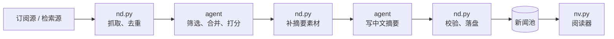

# news-pool

**让你已经在用的 AI agent（Codex、Claude Code、WorkBuddy……）每天替你筛选新闻。** 它从订阅源和新闻检索里抓取新闻，筛掉无关的，合并重复的，按重要性打分，写好中文摘要，存成本地文件，你在浏览器里阅读。整个流程都在 agent 里完成，用的是你已经订阅的套餐额度：**不需要 API key，不按量付费。**

[](https://github.com/lxucs/news-pool/actions/workflows/ci.yml)
[](LICENSE)


中文 | [English](README.en.md)


## 为什么用这个 skill

很多 AI 新闻摘要工具需要一个大模型 API key，按 token 计费。可很多人手里已经有 Codex、Claude Code 这类 agent 的订阅（ChatGPT、Claude 的套餐等），可以把订阅给利用起来，不额外付费。

所以 news-pool 把整套流程放进 agent 的 harness 里：

- **代码脚本做确定性的活**：抓取、规范化、去重、按时间窗过滤、校验、落盘。
- **agent 做脚本调用和内容分析**：按你的兴趣筛选，把报道同一件事的归成一个事件，打分，写标题、摘要和要点。

脚本和 agent 之间只靠 JSON 文件交接，脚本从不调用任何大模型 API。这样一来：

- **没有额外成本**：用的是你已经付过钱的 agent 套餐，不用申请 API key，也没有按次计费。
- **零依赖**：只要 Python 3.9 以上，全是标准库，复制过去就能跑。
- **数据在本地**：每条新闻一个 JSON 文件，放在 `~/.news-pool`；没有服务器，不需要账号设置。
- **不绑定 agent**：今天用 Codex，明天换 Claude Code，新闻池照样用。

## 不只是 AI 新闻

仓库自带五个示例 profile。第一次使用时，agent 会问你关注什么，然后从最接近的那个起步：

| 示例 | 关注什么 | 订阅源（节选） |
|---|---|---|
| `ai-zh`（默认） | 大模型、智能体、算力与芯片 | 量子位、新智元、AIHOT、智东西 |
| `finance-zh` | 宏观与货币政策、A 股 / 港股 / 美股、财报并购 | 华尔街见闻、FT中文网、界面新闻、中新网财经 |
| `games-zh` | 新作与销量、厂商动态、版号 | 机核、游研社、触乐、GameLook、IGN 中国 |
| `dev-zh` | 开源、编程语言、云与安全 | 开源中国、InfoQ、阮一峰的周刊、LWN |
| `science-zh` | 物理、生命科学、天文航天、医学研究 | Nature、Science、Quanta、New Scientist（英文源，摘要写成中文） |

都不合适也没关系。告诉 agent 你关心什么（新能源车、NBA、医药研发……），它会改好兴趣描述，并把这个领域的 RSS 订阅源（你给的，或者它帮你找的）写进 profile 的 `feeds.json`。微博、B 站、知乎这类没有 RSS 的站点，可以自建 [RSSHub](https://docs.rsshub.app) 转成 RSS，做法见 [sources.md](news-pool/references/sources.md#用-rsshub-订阅没有-rss-的站点)。

## 用起来是什么样


阅读器里，新闻按抓取日期分组，最重要的排在前面，每条都有中文标题、一句话摘要、展开的一段、三条要点和同一事件的其他报道。你可以搜索，按类别、标签、来源筛选，也可以星标、隐藏不感兴趣的、写笔记、整理收藏夹；有深色模式，用 `j` / `k` 翻条目，按 `?` 看全部快捷键。

## 安装

news-pool 是一个 skill，收新闻和读新闻都在里面，装一次就行。

需要 Python 3.9 或更新的版本（macOS 自带的就行），不用装任何依赖。

用 [skills](https://github.com/vercel-labs/skills) 安装（需要 Node.js）：

```bash
npx skills add lxucs/news-pool
```

用 Claude Code 的，也可以作为插件安装（在 Claude Code 里输入）：

```text
/plugin install news-pool --marketplace lxucs/news-pool
```

较早的 Claude Code 分两步：先 `/plugin marketplace add lxucs/news-pool`，再 `/plugin install news-pool@news-pool`。装好后显示为 `news-pool:news-pool`；更新时在终端里运行 `claude plugin update news-pool@news-pool`。

或者手动安装：克隆仓库，把 skill 目录 `news-pool/` 链接进 harness 的 skills 目录。

```bash
git clone https://github.com/lxucs/news-pool.git
cd news-pool

# Claude Code
mkdir -p ~/.claude/skills
ln -s "$PWD/news-pool" ~/.claude/skills/

# Codex
mkdir -p ~/.agents/skills
ln -s "$PWD/news-pool" ~/.agents/skills/

# WorkBuddy
mkdir -p ~/.workbuddy/skills
ln -s "$PWD/news-pool" ~/.workbuddy/skills/
```

其他 harness 放进各自的 skills 目录即可，复制也行。手动安装的，以后 `git pull` 就是更新。

抓取需要联网，沙箱型的 harness（例如 Codex）可能会请你放行；Google News 等来源要有相应的网络环境。阅读器只监听 127.0.0.1。

## 使用

**收新闻**：对 agent 说"抓今天的新闻""只跑量子位和 HN""看看最近关于 Sora 的新闻"或"把这几个链接收进来"。想调整关注点，就改 `<pool>/profile/config.json` 里的 `interests`（要什么、不要什么）和 `queries`（检索词），或者直接让 agent 改。每次运行从各来源上次抓到的地方接着抓，看过的不会再出现；harness 支持定时任务的话，可以让它每天早上跑一次。每次收完，agent 会直接打开阅读器，把地址给你。

**读新闻**：说"打开新闻"（或者自己运行 `python3 /path/to/news-pool/news-pool/scripts/nv.py up`），打开它给的地址。阅读器空闲两小时后自动退出，下次再打开即可。

数据都在新闻池里（默认 `~/.news-pool`，设置环境变量 `NEWS_POOL_DIR` 可以换位置）：

| 位置 | 内容 |
|---|---|
| `<pool>/profile/` | 你的 profile：兴趣、检索词、订阅源 |
| `<pool>/items/` | 条目：每条新闻一个 JSON 文件，写入后不再修改 |
| `<pool>/runs/` | 每次运行的目录；`manifest.json` 是这次运行收进来的条目列表 |
| `<pool>/viewer/` | 阅读器的数据：星标、已读、隐藏、笔记和收藏夹都在 `viewer.db` 里 |

格式的完整说明见 [`news-pool/references/schema.md`](news-pool/references/schema.md)。

## 工作方式



- **订阅源**：RSS / Atom（每个示例 profile 自带一份列表）和华尔街见闻；**检索源**：Google News，按你的检索词搜；Hacker News 和 GDELT 也支持，默认不启用。
- **没有正文的新闻不写摘要。** 订阅源里没有正文的条目直接跳过，每个源只取最新的 10 条（`per_source_limit`，可调）。Google News 的条目只有标题，主要用来补充同一事件的其他报道；只有它报道、又抓不到正文的新闻不收录。
- agent 写的每个文件都由 `nd.py check` 逐条校验：哪一条、哪个字段不对，期望什么，都会指出来，agent 照着改。
- 新闻池只增不改，阅读器只读不写（它自己的数据单独放在 `<pool>/viewer/`）。收新闻和读新闻两部分之间唯一的接口就是新闻池的格式。

## 尊重内容来源

新闻是记者和媒体的劳动成果。news-pool 只帮你发现和展示：

- **阅读器不展示原文。** 每条新闻只显示原标题，以及 agent 用自己的话写的中文摘要和要点；正文不提取、不保存、不展示。
- **每条都链回原文。** 「阅读原文」直接打开原站页面；同一事件的其他报道，也都链到各自的原站。
- **不绕过限制。** 不登录，不用 cookie，不绕过验证码和付费墙。请求量也小：通常每天运行一次，每个订阅源每次一个请求，限流严格的接口（如 GDELT）请求之间留出间隔。
- **只供个人阅读。** 新闻池在你自己的电脑上。如果要公开发布整理结果，请只用标题、自己写的摘要和原文链接，并遵守各来源的使用条款。

## 开发

```bash
uv sync          # 创建开发环境（pytest、ruff、pyright）
uv run pytest    # 离线测试，不联网
```

开发约定见 [AGENTS.md](AGENTS.md) 和 [docs/contributing.md](docs/contributing.md)。

## 许可

[MIT](LICENSE)
